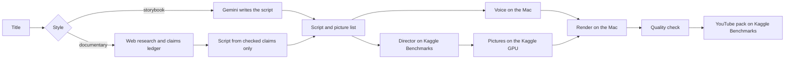

# History Studio

History Studio turns a title into a finished, long YouTube history video. You type something like
"The Fall of Constantinople 1453" and about an hour and a half later there is a 20 to 25 minute film on disk:
narration in my own cloned voice, pictures, camera moves, captions, music, sound effects, a thumbnail, subtitles
and a ready YouTube title and description.

It runs on a MacBook Air M2 with 16 GB of RAM and free services only. The heavy picture work goes to Kaggle's free
GPU, the planning goes to the strongest model on Kaggle Benchmarks, and the Mac does the voice and the final render.

I built it for my channel about military history, so the defaults lean that way, but any history topic works.

## Two editing styles

You pick one in the dashboard before a video starts.

| | Storybook (cartoon) | Documentary (real look) |
| --- | --- | --- |
| You give | a title, or your own script | a title or a headline |
| Script | written by Gemini from the title | written only from checked research claims |
| Research | the model's own knowledge | 100 to 150 web sources read in full |
| Pictures | illustrated picture book scenes | realistic photographs |
| Proof on screen | maps, title cards, fact captions | the same, plus screenshots of the real articles |
| Movement | the character is cut out and breathes and sways | camera moves only, no faces of real people |
| Typical length | 5 to 90 minutes, you choose | about 22 minutes |

A third style, pencil sketch, uses the storybook pipeline with grey pencil drawings.

## How a video gets made



The voice, the director and the pictures run at the same time, so the slowest of them sets the pace, not the sum.

1. **Script.** Every chapter is written to a word target (about 188 spoken words a minute in my voice). A chapter that
   comes back short is asked for again, so a 22 minute video really is 22 minutes.
2. **Voice.** Chatterbox (MLX build for Apple Silicon) clones my voice from a short sample. Each chapter is cached
   by the hash of its text, so editing one chapter only remakes that chapter's audio. `align.py` then finds the
   exact time of every word, which is what lets a caption land on the spoken word.
3. **Director.** The strongest model available on Kaggle Benchmarks plans the edit, sentence by sentence (below).
4. **Pictures.** All pictures of the video go to the Kaggle GPU in one run (below).
5. **Render.** ffmpeg puts it together. Transitions and light leaks come from Remotion, animated titles and
   kinetic captions from HyperFrames, and `sound.py` mixes a mood based music bed, place sounds and the sound hits.
6. **Quality check.** `qa.py` measures the finished file: cuts per minute, shot length, movement, caption time, sound
   effects per minute, loudness (it aims at YouTube's -14 LUFS), how close a card lands to its spoken word, and the
   longest still moment.
7. **YouTube pack.** Five title options, a description, hashtags, tags and thumbnail text, based on real search
   data (below).

## How the GPU is used

The Mac has no CUDA, and drawing a picture there took minutes. Kaggle gives a free notebook with two T4 GPUs
(15 GB each), so `kaggle_gpu.py` sends the work there.

- **One run per video.** All the picture prompts of a video are packed into one private Kaggle script and pushed
  with the Kaggle CLI. Both T4s draw at the same time, one SDXL pipeline each, in fp16.
- **Models.** The storybook look uses an SDXL Lightning model with style LoRAs. The documentary look uses SDXL base
  with the SDXL Lightning 8 step LoRA at 1344 x 768. A picture takes about 7 to 9 seconds.
- **Cutouts on the GPU.** For storybook pictures with someone in them, BiRefNet cuts the figure out, and LaMa plus a
  light SDXL inpainting pass paints the empty background behind it. The Mac then moves the figure on its own layer.
  If those models fail to load, the pictures are still drawn and only the cutout is skipped.
- **The session always closes.** The push carries a time limit, so no GPU hours keep running if something hangs.
  A video of about 100 pictures uses roughly 15 to 20 minutes of the weekly GPU quota.
- **Queues are handled.** On a busy day a run can sit in Kaggle's GPU queue for over an hour. Only running time
  counts against the limit, the queue may take up to `KAGGLE_QUEUE_HOURS` (6 by default), and if the same pictures
  are already queued or running on Kaggle, nothing new is pushed: the build waits for that run.
- **Nothing is drawn twice.** Before pushing, the code reads the last finished Kaggle run. Every picture with the
  same words, seed and model settings is downloaded from it instead of drawn again. This saved a whole build when a
  run finished after the Mac had stopped waiting.
- **Pictures never fall back to the Mac by accident.** With `MAC_PICTURES=0` the build stops with a clear message
  if pictures are missing, instead of quietly spending an hour drawing on the Mac.

## How Kaggle Benchmarks is used

Kaggle Benchmarks lets you run a "task" against hosted frontier models from the Kaggle CLI. A benchmark run costs no
GPU hours. History Studio uses it as free access to the strongest models.

**The director** (`director.py`). For every chapter the model answers three prompts:

- *Edit:* where a proof card, a map or a document goes, and on which word it lands.
- *Beats:* a caption, the music mood, the place sound and the turning points for every sentence.
- *Direct:* for every sentence the camera move (push, pull, pan, rise, dive, drift or shake), the pace, the
  transition into it (zoom blur, cross zoom, film burn, dreamy zoom, iris, clock wipe, wipe or fade), light leaks,
  how its caption animates, one sound design hit on its key word, particles in the air, the chapter opening, and the
  one sentence before which the music drops out so the reveal hits harder.

All prompts of a video go in a single benchmark run, two at a time. Models are tried in order
(`claude-opus-5-5-default`, then `gpt-6.1-sol`, then `gemini-4-argon`), and whatever one model leaves unanswered goes
to the next. Anything still missing is planned by the Gemini API key, so a video never stops here. The code also
keeps the taste in check: two transitions at least 6 seconds apart, at most two light leaks a chapter, and no sound
hit on top of another. Kaggle reserves the cost of the longest possible answer before each call, so every answer is
capped (`DIRECTOR_TOKENS`, 16000 by default). Without the cap the quota ran out after three answers.

**The YouTube pack** (`meta.py`). yt-dlp searches YouTube for the subject (no login, no API key) and keeps the long
videos with their views. Every title is measured for the patterns history channels use: a number, a question, a
colon, an ALL CAPS word, a strong word, its length. Each pattern gets its median views against titles without it.
`gemini-4-argon` then writes the pack from the script and that evidence. Chapter times and image credits are added by
the code, so they are exact.

## How the documentary research works

`documentary/` is a separate pipeline in front of the normal build. Give it a title and it researches first.

1. **Searches.** Gemini turns the title into 24 searches from different angles, and after the first round writes 14
   more for whatever the sources found so far do not cover.
2. **Sources.** Free search engines answer in turn through `ddgs` (DuckDuckGo, Bing, Brave, Mojeek, Yahoo and
   others), so one engine's rate limit does not lose half the searches. The links that Wikipedia's own articles cite
   are added too. Pages and PDFs are read in full with trafilatura and pypdf, up to 150 sources and 4 per site, so no
   single outlet carries the film.
3. **Claims ledger.** Every source is read for its facts. A claim is kept only if the quote it rests on really
   appears in that page; a made up quote drops the claim. Claims are merged across sources in small pieces, then
   marked confirmed (two or more sites), reported, alleged or disputed.
4. **Script.** Chapters are written only from ledger claims, with a claim behind at least every second sentence.
   Allegations about real people stay worded as allegations.
5. **Screenshots.** Playwright opens each source at 1600 x 900 and clears cookie banners. Before saving anything it
   checks that the page on screen is the article research read: a Cloudflare check, an "Access denied" wall or a
   captcha shares almost none of the article's words and is refused. For every source card the script uses, the
   exact words the narration rests on are found on the page, marked in yellow and scrolled into the middle.
6. **Religious claims.** For stories from Islamic history, claims about the Prophet, the Sahaba or matters of faith
   are kept only when they come from the Sunni books or sites in `documentary/sunni_books.json` (Sahih al-Bukhari,
   Ibn Kathir, al-Tabari, Ibn Hisham and others). The script names the book when it tells such a claim. Battles,
   numbers and places are researched on the open web as usual. `DOC_SUNNI=0` turns this off.

On the Constantinople test this went from 29 sources and 85 claims in the first version to 118 sources from 89 sites,
615 claims and 54 article screenshots in the film.

## Results so far

| Video | Style | Length | Final run time | Quality check |
| --- | --- | --- | --- | --- |
| The Fall of Constantinople 1453 | documentary | 24.8 min | 77 min | 9 of 10 |
| Jensen Huang resigns (Nvidia) | documentary | 25.1 min | 107 min | 10 of 10 |
| The Tigris crossing | storybook | 2.0 min | 13 min | 10 of 10 |

Measured on the M2: the voice takes about 0.6 to 1 minute per minute of video, the render about 1.2 to 1.5.

## Running it

You need macOS on Apple Silicon, Python 3.11, Node 22 for the effects, a Gemini API key and a Kaggle account with
phone verification (for GPU and internet).

```bash
python3.11 -m venv .venv-mlx && source .venv-mlx/bin/activate
pip install -r requirements.txt
playwright install chromium
python fx.py setup                      # Node packages for HyperFrames and Remotion
cp .env.example .env                    # then fill in LLM_API_KEY
# put your Kaggle token at ~/.kaggle/kaggle.json
# put a 10 to 20 second clean sample of your voice at assets/my_voice.wav
python studio.py                        # opens the dashboard at http://127.0.0.1:8765
```

`History Studio.command` does the last step with a double click and keeps the Mac awake while videos are made.

In the dashboard you type a topic (or paste your own script), pick the editing style and the length, and add it to
the queue. It shows the step that is running, the research progress, the time left, the newest picture and the live
log. While one video renders, the next one's script or research is already being written.

From the terminal:

```bash
python make.py auto "The Lost Colony of Roanoke" --minutes 20      # storybook
python documentary/doc.py "The Fall of Constantinople 1453" 22     # documentary
RESEARCH_ONLY=1 python documentary/doc.py "..." 22                 # research and script, no film yet
python meta.py output/<video folder>                               # remake a YouTube pack
python clean.py output/<video folder>                              # delete working files, keep the upload set
```

The most useful settings in `.env`:

| Setting | What it does |
| --- | --- |
| `STYLE` | storybook, sketch or documentary |
| `KAGGLE`, `MAC_PICTURES` | pictures on Kaggle, never silently on the Mac |
| `KAGGLE_QUEUE_HOURS` | how long a run may wait in Kaggle's GPU queue |
| `DIRECTOR`, `DIRECTOR_MODELS`, `DIRECTOR_TOKENS` | the Kaggle Benchmarks director and its answer cap |
| `DOC_SOURCES`, `DOC_PER_SITE`, `DOC_SOURCE_GAP` | research depth and how often an article screenshot may show |
| `MUSIC_DB`, `SFX_DB`, `AMBIENCE_DB` | the sound mix |
| `FX`, `FX_TITLES`, `FX_CAPTIONS` | Remotion and HyperFrames effects |

## Running in the cloud (no computer on)

`cloud/` runs the same pipeline as three private Kaggle kernels that start each other:

1. **research** (CPU): web research, claims ledger, verified screenshots, script.
2. **gpu** (2 x T4): the edit plan, the voice (Chatterbox on CUDA instead of MLX) and the pictures, drawn on the same
   machine instead of a second kernel. Only this stage uses GPU hours.
3. **render** (CPU): effects, sound, render, quality check and YouTube pack. The video goes to your Drive folder and
   the link to Telegram with Yes and No buttons.

Between stages the video folder travels through Drive as `job_<id>.tgz`. The code, the assets (voice, music, sound
effects, fonts) and the secrets are three private Kaggle datasets that `python cloud.py sync` uploads from the Mac.
`python cloud.py start "Title" 22` starts a video, `python cloud.py day 5` starts day 5 of `plan.json`. A failure in
any stage is sent to Telegram.

A small Cloudflare worker (`cloud/cloudflare/worker.js`, put up with `python cloud.py worker`) is the part that is
always on:

- **Starts videos by itself.** Every half hour it checks: when nothing is running and today's count (4 by default,
  the day begins at 6:00 India time) is not reached, it pushes the research kernel for the next day of the plan
  straight to Kaggle's API. One video at a time; none when the week's 30 Kaggle GPU hours are nearly used. A day that
  fails twice is skipped and reported. It is turned on once with `/resume` and then runs until the plan is done.
- **Drive stays small.** The job folder is removed from Drive once the video is made.
- **Yes and No.** Every finished video comes to Telegram with its Drive link and the two buttons, one message per
  video. Yes approves it and gives it the next free publish slot: two a day, 11:00 AM and 5:30 PM New York. Four
  made a day fill two days of slots, so the rest wait for the next free day, and making never waits for a review.
  No asks what is wrong and keeps the reason and the screenshots you send for the fix step.
- **Upload settings.** `/settings` asks each setting once with its options (visibility, category, audience, license,
  comments and so on). The studio only writes the title, description, hashtags and captions. Paid promotion and AI use are always
  "No".
- **Commands.** `/status`, `/next`, `/day N`, `/pause`, `/resume`, `/perday N`, `/starthour H`.

The kernels report each stage, failure and finished video to the worker. Its state sits in Cloudflare KV.

## What is in the folder

| Path | What it is |
| --- | --- |
| `studio.py`, `dashboard.html` | the dashboard and its queue |
| `make.py` | the build: script, voice, pictures, timeline, render |
| `writer.py` | script writing and the edit plan prompts |
| `director.py` | the Kaggle Benchmarks director |
| `kaggle_gpu.py` | pictures, cutouts and backgrounds on the Kaggle GPU |
| `voice.py`, `align.py` | the cloned voice and exact word times |
| `visuals.py`, `cutout.py`, `motion.py` | picture styles, cutouts and movement inside a picture |
| `render.py`, `cards.py`, `fx.py`, `hf.py`, `fx/` | the render, on screen cards, Remotion and HyperFrames effects |
| `sound.py` | music, place sounds and sound hits |
| `qa.py` | the quality check |
| `meta.py` | the YouTube pack |
| `documentary/` | research, claims ledger, article screenshots and the documentary script |
| `cloud.py`, `cloud/` | the Kaggle stages, Drive and Telegram, and the Cloudflare worker |
| `samples/` | the script format and example scripts |

Not in the repository on purpose: my voice samples, the music and sound effect files, the reference videos, the
Real ESRGAN binary, and everything in `output/`. Bring your own voice, music and sound effects.

## Things that are not solved yet

- **Faces in the realistic look.** AI photographs sometimes get faces and hands wrong. Real people are only shown from
  behind or far away, and their real photos appear only inside article screenshots.
- **Kaggle queues** can still delay a video by an hour or more on busy days.
- **YouTube's API** keeps uploads from unverified projects private until the project passes an audit, so automatic
  publishing has to wait for that.
- **Real people in the news.** The script keeps allegations as allegations, but such videos still need a human read
  before upload. Mark AI pictures as altered or synthetic content when you upload.

Next on the list: fixing a rejected video from the reason and screenshots sent on Telegram, and the YouTube upload
with its publish slot.
